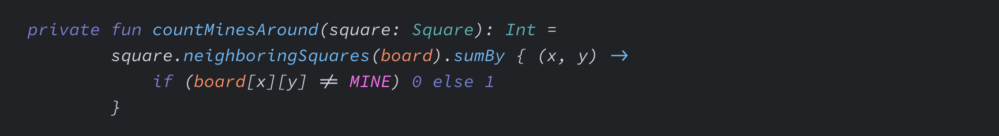

<p align="center"></p>

# Ligaturizer


Add ligatures to any coding font. Ligaturizer is a [FontForge](https://fontforge.org/) Python script that copies the ligatures (glyphs and rendering rules) from [Fira Code](https://github.com/tonsky/FiraCode) into any TrueType or OpenType font. The ligatures are scale-corrected but otherwise copied as is; no new ligature artwork is drawn to match the target font.

> **This fork** adds the [Fira Code](https://github.com/tonsky/FiraCode) 6.2 ligatures to [Source Code Pro](https://github.com/adobe-fonts/source-code-pro). Building it produces `LigaSrcPro-*.ttf` in all weights and italics in `fonts/output/`.

## Quick start

```sh
git clone --recurse-submodules https://github.com/yashLadha/Ligaturizer.git
cd Ligaturizer
make
```

The ligaturized fonts are written to `fonts/output/`. To build without installing FontForge locally, see [Docker](#docker).

## Examples

This fork's Source Code Pro in Regular (`LigaSrcPro-Regular`) and Italic (`LigaSrcPro-It`), with ligatures for `->` and `!=`:




## Requirements

- **Submodules:** the coding fonts and Fira Code are git submodules, so clone with `--recurse-submodules`.
- **Fira Code TTFs:** by default the ligatures are read from `fonts/fira/distr/ttf/FiraCode-<Weight>.ttf`, picked to match the input font's weight. The Fira Code 6.2 source checkout does not include these files; copy the `ttf/` folder from the Fira Code release there, or pass `--ligature-font-file` (see [Manual](#manual-ligaturizepy)).
- **FontForge with Python bindings:**

  | Platform | Install |
  | --- | --- |
  | Debian / Ubuntu | `fontforge` and `python3-fontforge` packages |
  | openSUSE, NixOS | `fontforge` package (bindings included) |
  | macOS | `brew install fontforge` |

- **fontTools for Python 3:** used by `postprocess.py`, which `make` runs on every generated font. `make` does not fail without it, but the post-processing step is skipped.
- **Editor support:** see the [Fira Code README](https://github.com/tonsky/FiraCode) for editors that render ligatures.

As an alternative to installing these locally, use the [Docker](#docker) image.

## Usage

### Automatic (make)

1. Put the font(s) you want to ligaturize in `fonts/`.
2. Edit `ligatures.py` to comment out any ligatures you don't want, and/or enable individual (non-ligature) characters to copy from Fira Code.
3. Edit `build.py` and add a glob for your font(s) to one of:
   - `prefixed_fonts`: the family name gets the `Liga` prefix (e.g. `'FooFont*'` covers every weight of FooFont).
   - `renamed_fonts`: maps a glob to a new family name, for licenses that require modified fonts to be renamed.
4. Run `make`.
5. Collect the fonts from `fonts/output/`.

| Target | Result |
| --- | --- |
| `make` (`without-characters`) | Ligatures only, in `fonts/output/` |
| `make with-characters` | Ligatures plus Fira Code punctuation glyphs, in `fonts/output-with-characters/` |
| `make all` | Both of the above |
| `make release` | `clean`, `all`, then zips both into `LigaturizedFonts.zip` and `LigaturizedFontsWithCharacters.zip` |
| `make clean` | Removes generated fonts and zips |

### Manual (ligaturize.py)

1. Copy the font you want to ligaturize into `fonts/` (or anywhere convenient).
2. Edit `ligatures.py` to comment out any ligatures you don't want.
3. Run the script:

   ```sh
   fontforge -lang=py -script ligaturize.py path/to/input/font.ttf \
     --output-dir=path/to/output/dir/ \
     --output-name='Name of Ligaturized Font'
   ```

For example, this produces `fonts/output/LigaturizedCousine-Regular.ttf`:

```sh
fontforge -lang=py -script ligaturize.py fonts/Cousine-Regular.ttf \
  --output-dir=fonts/output/ \
  --output-name='Ligaturized Cousine' \
  --prefix=''
```

The weight/style suffix (e.g. `-Regular`) is kept from the input font, and the output is OTF if the input is OTF, TTF otherwise.

| Option | Description |
| --- | --- |
| `--output-dir DIR` | Directory to write the font to. Required; there is no default. |
| `--output-name NAME` | New family name, replacing the original. |
| `--prefix STR` | Prepended to the family name. Defaults to `Liga`, so it also applies with `--output-name`; pass `--prefix=''` to disable it. |
| `--ligature-font-file PATH` | Font to copy ligatures from. Defaults to the matching weight in `fonts/fira/distr/ttf/`. |
| `--copy-character-glyphs` | Also copy individual punctuation glyphs listed in `ligatures.py`, so they match the ligatures more closely. |
| `--scale-character-glyphs-threshold N` | When copying character glyphs, scale them horizontally if their width differs from the input font by at least this fraction. Default `0.1`; `0` scales all, `2` effectively disables scaling. |

Run `fontforge -lang=py -script ligaturize.py --help` for the full help text.

### Docker

The `Dockerfile` provides FontForge with its Python bindings, fontTools, `make` and `zip`, so nothing else needs to be installed on the host. The repo is bind-mounted into the container at run time, so check out the submodules first (see [Requirements](#requirements)).

Build the image from the repo root:

```sh
docker build -t ligaturizer .
```

Run the default build (equivalent to `make`). Running as your own uid/gid keeps the files in `fonts/output/` from being owned by root:

```sh
docker run --rm -u "$(id -u):$(id -g)" -v "$PWD":/work ligaturizer
```

Run the unit tests instead of a build (they also run locally with plain `python3`, no FontForge needed):

```sh
docker run --rm -u "$(id -u):$(id -g)" -v "$PWD":/work ligaturizer \
  python3 -m unittest discover -s tests -v
```

Any other `make` target works the same way, e.g. a full release zip:

```sh
docker run --rm -u "$(id -u):$(id -g)" -v "$PWD":/work ligaturizer make release
```

## Pre-built fonts

This fork does not publish releases. Upstream [ToxicFrog/Ligaturizer releases](https://github.com/ToxicFrog/Ligaturizer/releases) offer pre-ligaturized fonts built with an older Fira Code; they do not include this fork's Fira Code 6.2 changes or the `LigaSrcPro` fonts.

## Credits

Originally written by [IlyaSkriblovsky](https://github.com/IlyaSkriblovsky) to add ligatures to DejaVu Sans Mono ([dv-code-font](https://github.com/IlyaSkriblovsky/dv-code-font)). [Navid Rojiani](https://github.com/rojiani) generalized the script to work with any font, and [ToxicFrog](https://github.com/ToxicFrog) has made a large number of contributions.

## Contributing

Contributions are welcome. Open a pull request, or an issue for a bug or feature idea.

## Related projects

More programming fonts with ligatures:

- [Fira Code](https://github.com/tonsky/FiraCode)
- [Hasklig](https://github.com/i-tu/Hasklig)
